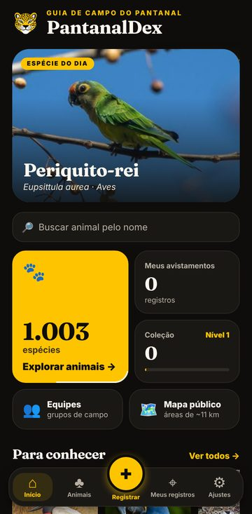
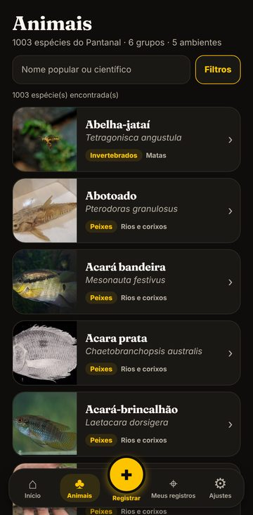
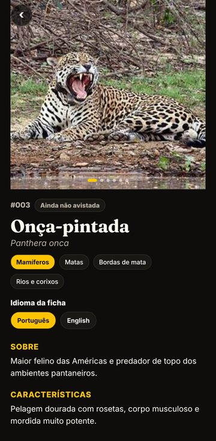
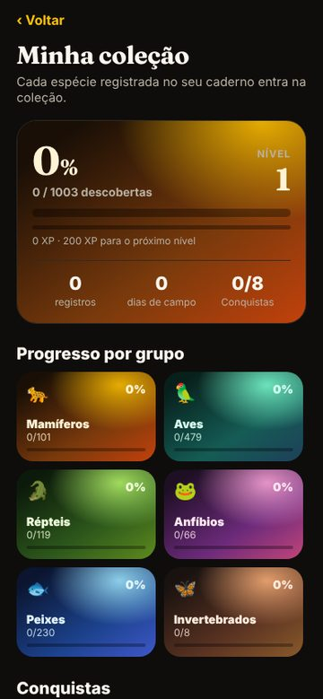

<div align="center">


# PantanalDex

**Guia de campo offline, cadernos de avistamentos e equipes de campo da fauna do Pantanal.**
Gratuito · sem anúncios · funciona sem internet

### [⬇️ Baixar o APK para Android](https://github.com/Souzzao/pantanal-dex/releases/latest)
<sub>`PantanalDex.apk` = versão final · `PantanalDex-Demo.apk` = demonstração (caderno Teste e auditoria simulada)</sub>

[](https://github.com/Souzzao/pantanal-dex/actions/workflows/ci.yml)
[](https://github.com/Souzzao/pantanal-dex/actions/workflows/apk.yml)


</div>

<p align="center">
  
  
  
  
  
</p>

---

## Sobre o projeto

Quem visita o Pantanal vê uma onça, um tuiuiú ou um jacaré e fica com as mesmas dúvidas: **que bicho é esse, o que ele come, está ameaçado?** As fotos acabam perdidas na galeria, sem nome e sem local, e no campo quase nunca há sinal de celular.

O **PantanalDex** resolve isso em um único app que funciona **sem internet**:

- 📖 **Wiki na palma da mão** — 1.003 espécies do Pantanal, com até 6 fotos de licença livre cada (5.600 no total), dieta, grau de ameaça (IUCN) e fontes.
- 📷 **Organiza as fotos** — cada avistamento guarda espécie, foto, data, hora e local.
- 📍 **Localiza os animais** — mapa com a área aproximada de cada registro público.
- 🌎 **Tradução** — interface e fichas em português, inglês, espanhol e alemão.
- 👥 **Equipes de campo** — grupos de até 100 pessoas com progresso, conquistas e estudo das zonas onde cada espécie foi vista.
- 🏅 **Explorador do Pantanal** — check-in por GPS em 35 pontos turísticos e cidades pantaneiras, com insígnias.

> Projeto idealizado e desenvolvido por **Felipe de Souza Aquino** como trabalho final da disciplina de Engenharia de Software (UNEMAT, 2026).

## Funcionalidades

| Área | O que faz |
|---|---|
| **Catálogo** | 1.003 espécies (mamíferos, aves, répteis, anfíbios, peixes e invertebrados), busca por nome popular ou científico, filtros por grupo, ambiente e ameaça. |
| **Ficha da espécie** | Descrição, dieta medida (EltonTraits/AmphiBIO), massa corporal, status IUCN, curiosidades, fontes e créditos de imagem, em 4 idiomas. |
| **Novo avistamento** | Abre a câmera na hora, lê o GPS, confere se o ponto está no Pantanal e salva no caderno local. Alternativas: galeria e marcação manual no mapa. |
| **Equipes** | Criar ou entrar por um código de 8 letras, até 100 pessoas, 9 conquistas da equipe, ranking e zonas de ~11 km estudadas. Funciona offline; sair exige confirmar o nome da equipe; a equipe nunca vê o ponto exato. |
| **Cadernos** | Avistamentos separados em cadernos (Principal, Teste na versão Demo, criados e importados). Juntar cadernos removendo repetidos, importar e exportar em JSON, CSV ou GeoJSON, com histórico dos cadernos exportados. |
| **Mapa público** | Registros auditados exibidos como círculos de até 3 km (o tamanho depende do animal), filtros por espécie, grupo e data. Nunca mostra o ponto exato. |
| **Pontos turísticos** | 19 atrativos e 16 municípios pantaneiros, check-in validado por distância (Haversine) e precisão do GPS. |
| **Coleção** | XP, nível, progresso por grupo, conquistas e insígnias Bronze, Prata e Ouro. |
| **Auditoria** | Fila em cartões (arrastar para aprovar ou recusar), correção de espécie e histórico. Modo demonstração simula publicações e o processo completo, sem enviar nada ao servidor. |
| **Contas e perfis** | Login com Supabase Auth e três perfis: **usuário** (registra), **auditor** (aprova, corrige ou recusa registros públicos) e **dev** (gerencia contas e papéis). |
| **Offline** | Catálogo, caderno e mapa funcionam sem rede; fotos do catálogo podem ser baixadas para uso offline. |
| **Duas versões** | **PantanalDex** (final, para a loja) e **PantanalDex Demo** (caderno Teste e auditoria simulada), geradas do mesmo código por `APP_VARIANT`. |
| **Privacidade (LGPD)** | Aceite da política na criação da conta, excluir conta pelo app, local exato só no aparelho, sem backup automático do Android. [Política de privacidade](docs/PRIVACIDADE.md). |

## Tecnologias

- **App:** Expo SDK 54, React Native 0.81, React 19, Expo Router, NativeWind (Tailwind), TypeScript, Reanimated e SVG (animações inspiradas no kit Órbita UI / Magic UI), fonte Fraunces.
- **Mapa:** Leaflet em WebView, contorno oficial do Pantanal (IBGE) e camada de satélite.
- **Back-end:** Supabase (Auth, Postgres com Row Level Security e funções RPC para publicação, auditoria e equipes).
- **Dados:** pipeline Python que monta o catálogo a partir de iNaturalist, GBIF, EltonTraits 1.0, AmphiBIO, Wikidata e Wikimedia Commons.
- **Qualidade:** Vitest (200+ testes), TypeScript estrito, GitHub Actions (verificação em todo PR e APK a cada mudança).

## Começando

Requisitos: **Node.js 20+** e **pnpm 9**.

```bash
git clone https://github.com/Souzzao/pantanal-dex.git
cd pantanal-dex
pnpm install --frozen-lockfile
cp .env.example .env      # opcional: sem o .env o app roda em modo local, sem login
pnpm start                # abre o Expo (Android, iOS ou web)
```

Comandos úteis:

| Comando | Para quê |
|---|---|
| `pnpm start` | Servidor de desenvolvimento do Expo |
| `pnpm android` | Abre no emulador ou aparelho Android |
| `pnpm check` | Verificação de tipos (TypeScript) |
| `pnpm test` | Testes automáticos |
| `pnpm catalog:build` | Regenera o catálogo de espécies a partir de `data/` |

Para gerar o APK, configurar o Supabase e rodar os testes no Android, veja **[docs/COMO-RODAR.md](docs/COMO-RODAR.md)**.

## Estrutura do repositório

```
app/            Telas (Expo Router): abas, ficha da espécie, avistamentos, mapa, coleção, auditoria, área dev
components/     Componentes de interface reutilizáveis (mapa, cartões, login, imagens)
contexts/       Estado global: conta (Auth), preferências e caderno (App), publicações
shared/         Regras de negócio puras e testáveis: catálogo, avistamentos, mapa, check-in, i18n
  catalog/      Catálogo gerado (1.003 espécies) e auditoria de licenças
  i18n/         Textos da interface em pt, en, es e de
lib/            Integrações: cliente Supabase, fotos, tema
supabase/       Migrações SQL (tabelas, RLS e funções do servidor)
scripts/        Pipeline do catálogo (Python) e utilitários de build
tests/          Testes automáticos (Vitest)
docs/           Documentação técnica
```

## Documentação

| Documento | Conteúdo |
|---|---|
| [Arquitetura](docs/ARQUITETURA.md) | Camadas, fluxo de dados, offline-first e decisões técnicas |
| [Engenharia de software](docs/ENGENHARIA.md) | Problema, escopo, stakeholders, requisitos, casos de uso e diagramas UML |
| [Segurança](docs/SEGURANCA.md) | Modelo de ameaças, RLS, perfis, privacidade da localização |
| [Como rodar](docs/COMO-RODAR.md) | Ambiente, Supabase, APK e testes no Android |
| [Dados do catálogo](docs/DADOS.md) · [Pipeline](docs/PIPELINE-CATALOGO.md) | Origem e montagem das 1.003 espécies |
| [Privacidade](docs/PRIVACIDADE.md) · [Google Play](docs/GOOGLE-PLAY.md) | Política (LGPD) e roteiro de publicação na loja |
| [Licenças de terceiros](docs/LICENCAS-TERCEIROS.md) | Bibliotecas, fontes e referências de interface |
| [Checklist de interface](docs/CHECKLIST-INTERFACE.md) | Revisão visual e de acessibilidade com evidências (kit Órbita UI) |
| [Licenças e créditos](docs/LICENCAS-E-CREDITOS.md) | Regras de licença das imagens e fontes |
| [Mapa público](docs/MAPA-PUBLICO.md) | Como os registros viram áreas aproximadas |
| [Testes](docs/TESTES.md) | Estratégia de verificação e validação |
| [Histórico de versões](CHANGELOG.md) | O que mudou em cada versão |

## Segurança

Encontrou uma falha? **Não abra issue pública** — veja [SECURITY.md](SECURITY.md).

## Autor

**Felipe de Souza Aquino** — idealização, especificação, desenvolvimento, testes e revisão.
GitHub: [@Souzzao](https://github.com/Souzzao)

O desenvolvimento contou com apoio de assistentes de IA (Claude, GPT e Manus) como ferramentas de produtividade; todas as mudanças foram revisadas e aprovadas pelo autor antes de entrar no projeto.

<sub>A arte do topo foi gerada com IA (ChatGPT) para o projeto.</sub>

## Licença

© 2026 Felipe de Souza Aquino. Todos os direitos reservados — veja [LICENSE](LICENSE).
Os dados de terceiros seguem as licenças listadas em [docs/LICENCAS-E-CREDITOS.md](docs/LICENCAS-E-CREDITOS.md).
