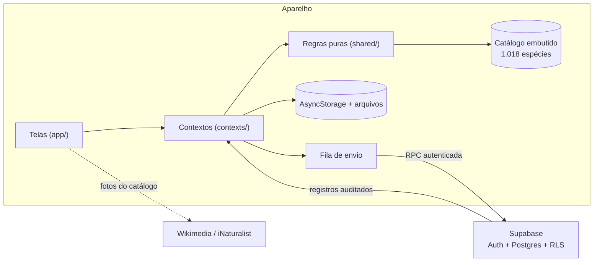

# Arquitetura

> Autor: Felipe de Souza Aquino · Versão 3.8

## Visão geral

O PantanalDex é um app **offline-first**: tudo o que a pessoa precisa em campo (catálogo, fichas, caderno e mapa) está dentro do aparelho. A internet só é usada para três coisas opcionais: entrar na conta, publicar um avistamento no mapa público e baixar as fotos do catálogo.

## Camadas

| Camada | Pasta | Responsabilidade |
|---|---|---|
| Telas | `app/` | Rotas do Expo Router. Só cuidam de exibição e interação. |
| Componentes | `components/` | Peças reutilizáveis: mapa (`StreetMap`), cartão de ponto turístico (`SpotCard`), login, imagens com fallback. |
| Estado | `contexts/` | `AuthContext` (sessão e perfil), `AppContext` (preferências, avistamentos e cadernos, por conta), `PublicationsContext` (fila e registros públicos). |
| Regras de negócio | `shared/` | Funções puras, sem React, cobertas por testes: validação de avistamentos, limites diários, geometria do Pantanal, check-in, filtros, i18n. |
| Integrações | `lib/` | Cliente Supabase, cópia permanente das fotos, tema. |
| Servidor | `supabase/migrations/` | Tabelas, políticas RLS e funções `SECURITY DEFINER` que validam cada operação. |
| Dados | `scripts/catalog/` + `data/` | Pipeline Python que gera `shared/catalog/generated/`. |

A regra principal é: **tela não decide regra**. Toda decisão (um ponto está no Pantanal? o check-in vale? o registro pode ser publicado?) mora em `shared/` e é testada isoladamente. O servidor repete as validações críticas, porque o app pode ser modificado por quem o instala.

## Fluxos principais

### Registrar um avistamento (UC05)

1. A tela `app/sightings/new.tsx` abre a câmera assim que é montada (`takePhoto(true)`).
2. A foto é copiada para a pasta permanente do app (`lib/sighting-photos.ts`).
3. O GPS é lido e `shared/pantanal-boundary.ts` confere se o ponto está dentro do contorno do IBGE.
4. `shared/sighting-rules.ts` valida data (não futura), limite de 30 registros por dia e campos obrigatórios.
5. O registro vai para o caderno local (`shared/notebook.ts` + `AppContext`).

### Publicar no mapa

1. O avistamento entra na fila de envio (`PublicationsContext`).
2. A função `publish_my_sighting` roda no servidor: confere o usuário, a data, o limite diário e arredonda a posição.
3. O registro fica **pendente** até um auditor chamar `review_sighting` (aprovar, corrigir ou recusar).
4. O mapa público só lê registros ativos e não recusados, exibidos como círculos (`shared/street-map.ts`).

### Cadernos

`shared/notebooks.ts` separa os avistamentos em cadernos (Principal, Teste, criados e importados) pelo campo opcional `notebookId`; registros antigos, sem o campo, ficam no Principal. `shared/notebook-files.ts` exporta um ou mais cadernos em JSON, CSV ou GeoJSON levando o nome do caderno e importa os três formatos, reconhecendo o formato pelo conteúdo. Juntar cadernos move os registros para o destino e pode remover duplicatas (mesma espécie, data, hora e local). O caderno Teste traz exemplos que não contam para a coleção nem para o limite diário.

### Check-in turístico

`shared/tourist-spots.ts` calcula a distância com a fórmula de Haversine. O check-in só vale se a precisão do GPS for de até 200 m e a pessoa estiver dentro do raio do ponto. As visitas ficam no aparelho e alimentam as insígnias de Explorador.

## Decisões técnicas

| Decisão | Motivo |
|---|---|
| Catálogo embutido no app | Uso em campo sem sinal; nada depende de rede para consultar uma espécie. |
| Leaflet em WebView | Mapa com satélite, rótulos e círculos sem SDK nativo pago; funciona igual no Android e na web. |
| Supabase com RLS | Autenticação pronta e regras de acesso dentro do banco, não só no app. |
| Funções RPC no servidor | O app nunca escreve direto nas tabelas públicas: toda escrita passa por uma função que valida. |
| Área aproximada no mapa | Proteger espécies ameaçadas e a privacidade de quem registra. |
| Raio por espécie (até 3 km) | Calculado pela raiz da massa corporal e pela fração de vertebrados na dieta: predadores grandes usam áreas maiores. |
| Regras em `shared/` | Testáveis sem emulador; 200+ testes rodam em segundos no CI. |

## Internacionalização

Os textos ficam em `shared/i18n/` (pt, en, es, de). As fichas trazem descrição e dieta traduzidas, montadas pelo pipeline do catálogo. O idioma é escolhido em Ajustes e há uma barra rápida para trocar sem sair da tela.

## Build e entrega

- **Verificação** (`.github/workflows/ci.yml`): TypeScript e testes em todo pull request.
- **APK** (`.github/workflows/apk.yml`): `expo prebuild` + Gradle, com o endereço e a chave pública do Supabase vindos dos *secrets* do repositório. O APK fica disponível como artefato da execução.
