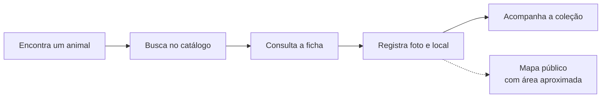
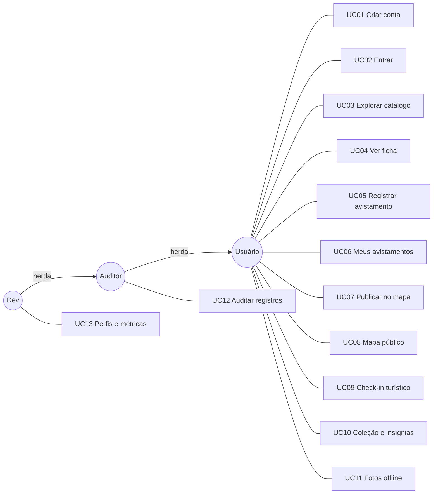
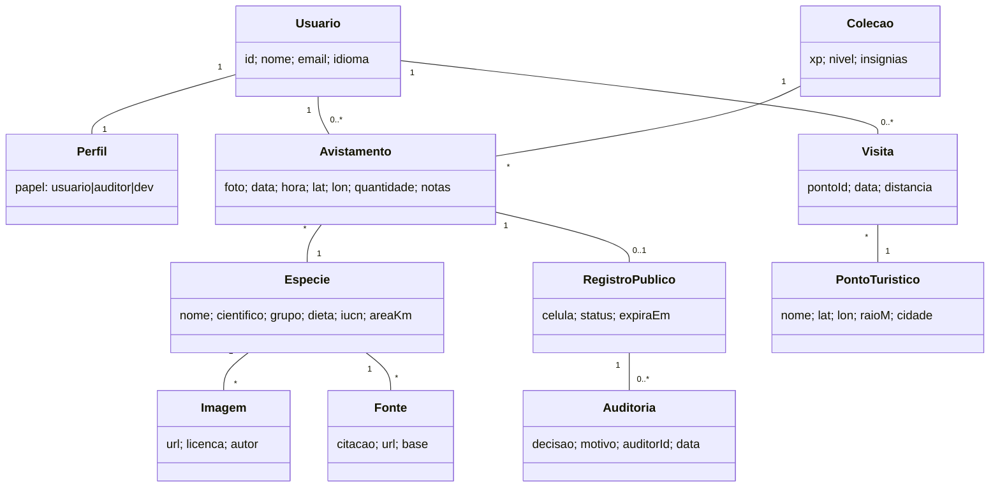
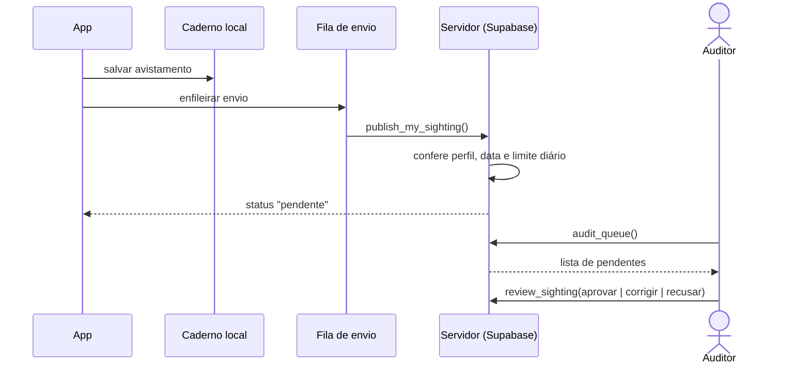
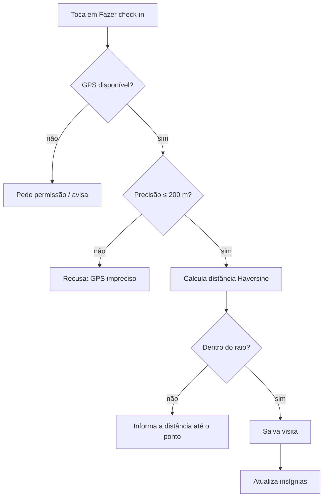

# Engenharia de software

> Autor: Felipe de Souza Aquino · Trabalho final de Engenharia de Software · UNEMAT · 2026

## 1. Problema, visão e escopo

**Problema.** Identificar e registrar a fauna do Pantanal em campo, onde quase nunca há internet. Hoje as fotos ficam perdidas na galeria, sem nome, local ou contexto.

**Origem da ideia.** A necessidade do próprio autor: organizar as fotos dos animais encontrados, saber onde cada bicho foi visto, ter tradução para turistas e uma wiki dos animais na palma da mão.

**Público.** Turistas, moradores, guias de turismo, estudantes e pesquisadores.

**Hipótese de valor.** Consulta offline + registro simples = a descoberta não se perde.

**Jornada de valor.**

**Escopo**

| Dentro | Fora (por enquanto) |
|---|---|
| Catálogo offline com 1.018 espécies | Identificação automática por IA |
| Caderno de avistamentos com foto e GPS | Uso para fiscalização ambiental |
| Mapa com área aproximada | Versão iOS e publicação nas lojas |
| Login com 3 perfis e auditoria | |
| Pontos turísticos, check-in e insígnias | |

## 2. Stakeholders

| Stakeholder | Interesse | Prioridade |
|---|---|---|
| Usuário (turista, morador, guia) | Identificar e registrar animais | Alta |
| Auditor | Garantir a qualidade dos registros públicos | Alta |
| Desenvolvedor | Manter e evoluir o sistema | Média |
| Professora / avaliação | Qualidade da engenharia | Média |

**Técnicas de levantamento:** persona (guia de turismo em Poconé), mapa de empatia do turista, análise de apps semelhantes (iNaturalist, Merlin Bird ID) e testes do APK a cada versão.

## 3. Requisitos

### Funcionais

| ID | Requisito |
|---|---|
| RF01 | Criar conta e entrar (e-mail e senha) |
| RF02 | Três perfis: usuário, auditor e dev |
| RF03 | Catálogo com busca e filtros (grupo, ambiente, ameaça, nome popular) |
| RF04 | Ficha da espécie em 4 idiomas, com dieta, IUCN e fontes |
| RF05 | Registrar avistamento com câmera e GPS |
| RF06 | Caderno de avistamentos com edição, exclusão e exportação CSV |
| RF07 | Publicar avistamento no mapa público |
| RF08 | Mapa público com filtros por espécie, grupo e data |
| RF09 | Auditoria de registros públicos (aprovar, corrigir, recusar) |
| RF10 | Área dev: contas, papéis e métricas |
| RF11 | Coleção com XP, níveis e conquistas |
| RF12 | Check-in em pontos turísticos e insígnias de Explorador |
| RF13 | Download das fotos do catálogo para uso offline |

### Não funcionais

| ID | Requisito |
|---|---|
| RNF01 | Offline primeiro: catálogo, caderno e mapa funcionam sem rede |
| RNF02 | Privacidade: o mapa público nunca mostra o ponto exato |
| RNF03 | Segurança: papel conferido no servidor; RLS em todas as tabelas |
| RNF04 | Interface em 4 idiomas e alvos de toque acessíveis |
| RNF05 | TypeScript estrito, testes automáticos e CI |

### Regras de negócio

| ID | Regra |
|---|---|
| RN01 | Registro só fica público após auditoria |
| RN02 | O mapa mostra uma área aproximada (célula + círculo de até 3 km) |
| RN03 | A data do avistamento não pode ser futura |
| RN04 | O ponto precisa estar dentro do Pantanal (contorno IBGE) |
| RN05 | Até 30 publicações por dia por conta |
| RN06 | Check-in só vale dentro do raio do ponto e com GPS de até 200 m de precisão |

### Dicionário de dados

| Termo | Significado |
|---|---|
| Avistamento | Registro de um animal visto: espécie, foto, data, hora, local, quantidade e notas |
| Célula pública | Área arredondada que substitui o ponto exato no servidor |
| Área da espécie | Círculo no mapa (até 3 km) calculado pela massa corporal e pela dieta |
| Status IUCN | Grau de ameaça global da espécie (LC, NT, VU, EN, CR) |
| Auditoria | Decisão de um auditor sobre um registro público: aprovar, corrigir ou recusar |

## 4. Casos de uso

### UC05 — Registrar avistamento

**Ator:** usuário. **Pré-condição:** app instalado (login não é obrigatório para o caderno local).

**Fluxo principal**
1. O usuário toca em *Novo avistamento*.
2. O app abre a câmera e o usuário tira a foto.
3. O app lê o GPS.
4. O app confere se o ponto está no Pantanal.
5. O usuário escolhe a espécie (ou "Não sei"), ajusta data, hora e quantidade.
6. O app salva o registro no caderno.

**Fluxos alternativos**
- 2a. Câmera negada → o app oferece escolher da galeria.
- 3a. Sem GPS → o usuário marca o local no mapa.
- 4a. Fora do Pantanal → o registro é recusado com aviso.
- 6a. Limite de 30 registros no dia → o app informa e não salva.

## 5. Diagrama de classes

## 6. Diagrama de sequência — publicar um avistamento

## 7. Diagrama de atividades — check-in

## 8. Metodologia

- **Design Sprint de 7 dias** para a primeira versão: mapear, esboçar, decidir, prototipar, testar, corrigir e apresentar.
- **Modelo iterativo e incremental** com quadro Kanban: o escopo evoluiu com o uso real do app.
- **Fluxo de trabalho:** cada funcionalidade nasce numa branch, vira pull request, é revisada e aprovada pelo autor, e o CI roda os testes e gera o APK.
- **Organização com assistentes de IA:** a produção evoluiu de agentes avulsos para uma orquestração com base de conhecimento (RAG) e distribuição de tarefas via n8n. A decisão final e a revisão de cada mudança sempre ficaram com o autor.

### Versões

| Versão | Entrega |
|---|---|
| 1.0 | Catálogo e caderno offline |
| 1.1 | Mapa público, login e auditoria |
| 1.2 | Fotos offline e 4 idiomas |
| 1.3 | 1.018 espécies, pontos turísticos e insígnias |

## 9. Qualidade

Critérios de qualidade: **confiabilidade offline** e **segurança da localização**.

- **Verificação** (construímos certo?): 200+ testes automáticos, TypeScript estrito e APK gerado a cada mudança.
- **Validação** (construímos o software certo?): uso real no celular e no emulador, com falhas observadas virando correções.

Detalhes em [TESTES.md](TESTES.md).

## 10. Limites conhecidos e próximos passos

| Limite atual | Próximo passo |
|---|---|
| 99 espécies sem nome popular em nenhuma base | Curadoria manual com especialistas |
| Tamanho de répteis e peixes estimado pela família | Integrar bases de traços específicas |
| Testado apenas no Android | Versão iOS e publicação nas lojas |
| Identificação depende do usuário | Identificação por foto com IA |
