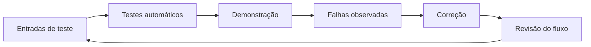

# Testes, verificação e validação

> Autor: Felipe de Souza Aquino

## Estratégia

| Nível | Ferramenta | O que cobre |
|---|---|---|
| Tipos | `pnpm check` (TypeScript estrito) | Contratos entre telas, contextos e regras |
| Unidade | `pnpm test` (Vitest) | Regras de negócio em `shared/` |
| Dados | `tests/pantanal.data.test.ts`, `tests/catalog-images-guard.test.ts` | IDs únicos, fontes, licenças e imagens do catálogo |
| Integração contínua | GitHub Actions | Tipos e testes em todo PR; APK a cada mudança na `main` |
| Validação | Celular e BlueStacks | Fluxos reais, permissões, câmera, GPS e mapa |

São **20 arquivos e 202 testes** automáticos, executados em poucos segundos.

## Suítes

| Arquivo | Regra testada |
|---|---|
| `sighting-rules.test.ts` | Data não futura, limite diário, campos obrigatórios |
| `sighting.flow.test.ts` | Fluxo completo de criar, editar e excluir avistamentos |
| `pantanal-boundary.test.ts` | Ponto dentro/fora do contorno do Pantanal |
| `tourist-spots.test.ts` | Distância Haversine, raio, precisão do GPS, insígnias |
| `street-map.test.ts` | Círculos por espécie (máximo de 3 km) e rótulos do mapa |
| `public-map.test.ts` / `public-feed.test.ts` | Filtros por data e espécie, células públicas |
| `collection.test.ts` | XP, níveis e conquistas |
| `offline-images.test.ts` | Download em paralelo com novas tentativas |
| `i18n.test.ts` | Textos completos nos 4 idiomas |
| `auth.test.ts` | Validação de cadastro e login |
| `exports-csv.test.ts` | Exportação do caderno |

## Cenários de teste do MVP

### CT01 — Check-in no Cristo Rei (Cáceres)

| Entrada | Esperado | Resultado |
|---|---|---|
| A 110 m do ponto, GPS de 15 m | Check-in aceito | ✅ Passou |
| A 5,5 km do ponto | Recusado, mostra a distância | ✅ Passou |
| GPS com 900 m de precisão | Recusado por imprecisão | ✅ Passou |

### CT02 — Catálogo completo

| Entrada | Esperado | Resultado |
|---|---|---|
| Abrir Animais sem filtros | 1.018 espécies | ❌ Mostrava 200 → corrigida a ordenação → ✅ reteste passou |

## Ciclo de correção

## Roteiro manual (antes de cada APK)

1. Abrir Início, Animais e uma ficha; trocar o idioma.
2. Filtrar por grupo e ameaça; conferir a contagem.
3. Novo avistamento: câmera, galeria, GPS e ponto manual; tentar ponto fora do Pantanal e data futura.
4. Editar e excluir um registro; exportar CSV.
5. Mapa público: filtros de data e espécie; tocar num ponto turístico e tentar o check-in.
6. Entrar com contas de usuário, auditor e dev; conferir o que cada uma vê.
